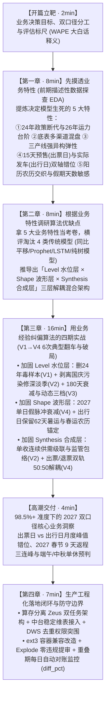
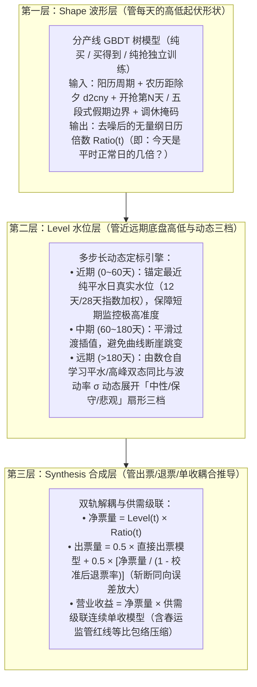

# 从业务直觉到 98.5%+ 准确率：国内火车票 2027 双口径（出票日 & 出行日）智能预测体系实战

> **分享人**：胡馨予 (hxy) · 携程火车票数据团队  
> **专项范围**：国内火车票（`partner_name = 'Ctrip.Train'` 纯 C 端基本盘）  
> **双轨交付**：
> - **出票日口径（Flow 交易流水视角）**：预测 `出票量 / 退票量 / 净票量 / 退票率 / 单票收益 / 营业收益`（Zeus `1618901` + `1619716`）
> - **出行日口径（Cohort 履约发车视角）**：预测 `出票量 / 退票量 / 净票量 / 退票率`（Zeus `1640532` + `1640698`）  
> **产线与档位**：`纯买 / 买得到 / 纯抢 / 合计` × `中性 / 保守 / 悲观` 全动态三档  

---

## 全篇分享逻辑主线（45 分钟全景图）

---

## 零、开篇立靶：预测服务于什么决策？怎么定义“准”？

在动手看数据和建模型之前，我们先明确**“靶心”**——为什么要同时做两套口径？怎么评判模型好坏？

### 1. 为什么要做「出票日」与「出行日」双口径？
| 维度 | **出票日口径（Flow 交易发生日）** | **出行日口径（Cohort 实际发车日）** |
|---|---|---|
| **时间锚点** | 用户在携程完成**购票/退票交易的日期 `d`** | 车票票面最终**实际发车的日期 `depart_date`** |
| **服务对象与场景** | **财务年度预算定盘、日常交易监控、变现产品单收管理** | **运力与履约峰谷评估、节假日真实客流洪峰保障** |
| **预测指标范围** | 票量四指标 + **单票收益 + 营业收益**（共 6 项） | **纯票量四指标**（出票量、退票量、净票量、退票率） |
| **数据成熟度特性** | **$T+1$ 完全冻结**：昨天的出票和退票今天就固定了，永不改变 | **存在 15 天在途预售期**：未来 14 天的发车日还在卖票和退票中 |

### 2. 评估标尺：为什么用 `WAPE`（加权绝对百分比误差）？
- **大白话解释 `MAPE` vs `WAPE`**：
  - 火车票除夕当天只有 60 多万张票，而春运返程高峰有 200 多万张票。如果用普通平均误差（`MAPE`），除夕差 6 万张就是 10% 误差，权重跟高峰日差 20 万张一样大，会被低谷日带偏。
  - 所以我们采用 **`WAPE`（加权绝对百分比误差）**，大白话就是：**「把一段时间内每天算错的票数绝对值加起来，除以这段时间的实际总票数」**：
    $$\text{WAPE} = \frac{\sum_{t} | \text{实际值}_t - \text{预测值}_t |}{\sum_{t} \text{实际值}_t}, \quad \text{准确率} = 1 - \text{WAPE}$$
  - **专项达标红线**：大盘近期盲测准确率 $\ge 97\%$（即 $\text{WAPE} \le 3\%$），且全年总盘严格对齐业务三档预算预期。

---

## 第一章：先摸透业务特性——前期描述性数据探查（EDA）

> **核心理念**：**描述性分析是预测的前提**。不先摸清火车票数据的“脾气”，盲目套用现成模型必然翻车。我们对 2024–2026 年底表做了系统性探查，提炼出决定模型选型的 **5 大核心特性**：

### 特性 1：历史政策断代与运力扩容的“非平稳台阶”
- **数据表现**：
  - **2024 年旧态不可比**：2024 年经历铁路退改费率政策重构与旧变现加速包治理下线，2024 年退票率高达 `26%~32%`（2026 年仅 `~17.6%`），单票收益结构完全不同；
  - **2026 年运力扩容新稳态**：2026 年 3–4 月起随 12306 供给扩充，大盘相比 2025 年出现约 `-10%~-12%` 的**台阶式下移**，而非匀速线性下滑。
- **对建模的要求**：**绝不能贪多把 2024 年放进训练集**；同时模型不能把 2025→2026 的台阶当成斜率一路线性往下滑。

### 特性 2：底表多渠道混盘
- **数据表现**：数仓核心汇总表 `cdm_dms_trn_ord_core_idx_sum_di` 内同时混有 `Ctrip.Train`（约占 48%）、智行（33%）、去哪儿（16%）、商旅（2.7%）、铁友与海外等。
- **对建模的要求**：不同品牌客群的价格敏感度与抢票习惯截然不同，必须严格剥离并锁死 `partner_name = 'Ctrip.Train'` 纯 C 端自营盘。

### 特性 3：三条产线（纯买 / 买得到 / 纯抢）脾气天差地别（强异构）
| 业务产线 | 净票量占比 | 收益贡献占比 | 平均退票率 | 平均单票收益 | 物理特性与供需规律（大白话） |
|---|---|---|---|---|---|
| **纯买** | **~58%** | ~42% | 13.2% | ~3.0 元 | **日常刚需基本盘**：有余票时用户直接买，平时稳如泰山，短途出行占主导 |
| **买得到** | **~34%** | ~33% | 22.4% (春运38%) | ~4.1 元 | **智慧中转/拼接方案**：用户常买多套方案备选，所以退票率比纯买高一大截 |
| **纯抢** | **~8%~10%** | **>25%** | 25.4% | **~9.3 元** | **极端脉冲型产线**：平时余票足几乎没人抢；一到国庆/春运放票首日或出行前夜**暴涨 20~49 倍**！ |

- **对建模的要求**：三条产线的波动规律完全不在一个频道上，**绝对不能把大盘混在一起建一个模型**，必须拆成三条产线各自独立建模，最后再加总合成。

### 特性 4：「15天预售期（出票日）」与「实际发车（出行日）」双时间轴错位
- **出票日（买票动作）**：最高峰根本不在放假当天，而是集中在**节前 12~14 天的放票开抢期**（`booking_day_index` 单个特征贡献度超过 **63%**！）；而除夕前 1~2 天则是集中退票潮（出票高、退票率飙升、净票被大幅冲减）。
- **出行日（乘车动作）**：没有提前半个月的漫长爬坡，客流高度浓缩在**「放假前 1 天夜里（离城洪峰）+ 假期首日 + 假期末日返程峰」**；且未来 14 天的出行日车票还没卖完、退票也没发生完（统计学叫**“右删失 Right-Censoring”**，大白话就是**“未来 14 天是还没封账的半成品数据”**）。

### 特性 5：阳历/农历双历法交织与“假期天数”敏感性
- **双历法漂移**：日常周末、元旦、五一、国庆按阳历走；但春节、端午、中秋按农历走，每年在阳历日历上前后漂移 10~20 天；调休补班的周末（周六/周日）数据表现完全等同于普通周二/周三工作日。
- **假期长度决定出行半径**：放 **3 天小长假**时，用户会跨省中短途旅游（买得到、纯抢暴涨）；而一旦变成**周三只放 1 天单休**（如 2027 年端午 6月9日、中秋 9月15日），用户不出远门，抢票脉冲断崖式缩水 **75%~80%**。

---

## 第二章：根据业务特性调研算法优缺点——为什么选定三层解耦架构？

> **核心理念**：拿着第一章摸清的 **5 大业务特性**当“考卷”，我们横向评测了市面上 5 类主流预测方法。淘汰前 4 种不是因为它们算法不好，而是因为它们撞上了火车票的业务特性硬伤。

### 1. 五大预测流派优劣横评表

| 候选预测方案 | 核心原理（大白话） | 优点 | 撞上了第一章哪条业务特性？（致命短板） | 选型结论 |
|---|---|---|---|---|
| **方案 1：传统同比乘数外推法** （SQL / Excel 同比平移） | 去年的今天是多少，今年乘以一个同比系数 | 简单透明，容易算年度大数 | **败在特性 4 & 5**：农历春节/端午/中秋每年阳历错位十几天，按阳历平移会把去年的春运抢票高峰对到今年的普通工作日；按农历平移又会对错周末和五一/国庆 | ❌ 仅能拍年度总量，无法做按天预测 |
| **方案 2：经典统计与开源时序** （SARIMA / Holt-Winters / Prophet） | 把曲线拆成“一条直线趋势 + 固定周期波浪 + 简单假日加分” | 开源现成，适合平稳周期的零售数据 | 1. **败在特性 1**：把 2025→2026 的台阶式下移当成斜率一路往下画直线，2027 下半年直接跌穿； 2. **败在特性 3 & 4**：加性或简单乘性波浪根本拟合不了纯抢 **30~49 倍**的脉冲尖峰，也处理不了“开抢期买票 + 节前退票”的错位耦合 | ❌ 节假日波峰被严重削平，远期趋势崩盘 |
| **方案 3：端到端深度学习模型** （LSTM / DeepAR / Transformer） | 用神经网络黑盒直接从过去几百天猜未来 365 天 | 数据量极大时非线性拟合能力强 | 1. **败在特性 1（样本太少）**：剔除 2024 年后有效样本仅 **~650 天**，像除夕、国庆首日这种极端日子两年只出现过 1~2 次，神经网络根本学不会； 2. **黑盒不可控**：无法把业务拍板的三档预算目标和春运单收监管红线塞进黑盒里 | ❌ 小样本过拟合、极值失真、无法业务调优 |
| **方案 4：纯树模型直接回归绝对值** （GBDT / LightGBM 直接预测每日票数） | 用日历特征建几百棵决策树，直接猜每天卖多少张票 | **极擅长学复杂日历交互**（如“开抢第1天+周五+春运”） | **败在特性 1（决策树不会外推新趋势）**：大白话叫**“树模型没法猜出历史范围以外的数字”**——它输出的平均值永远被锁死在 2025–2026 的历史均值里，无法体现近期水位下降和 2027 年的预算收缩 | ❌ 每天的高低起伏形状很准，但整体水位偏高锁死在过去 |
| **方案 5（最终选定）：** **「Level 水位层 × Shape 波形层 × Synthesis 合成层」三层解耦混合架构** | **把“底盘水位”和“每天的起伏倍数”拆开算！** $\text{预测值}_t = \text{底盘水位 Level}_t \times \text{日历起伏倍数 Ratio}_t$ | **扬长避短，白盒可控**： • 让树模型只管学“今天是平时的几倍（Shape）”； • 让统计定标层负责“今年底盘是多少万张（Level）”； • 第三层负责算退票率和单票收益（Synthesis） | **完美攻克全部 5 大特性**： • 分产线建模攻克**特性 3**； • 树模型学比率攻克**特性 4 & 5**； • 动态水位层攻克**特性 1**； • 650 天样本即可达到 98.5%+ 准度 | ✅ **最终中标架构** |

### 2. 三层解耦混合架构全景图

---

## 第三章：用业务经验纠偏算法的四期实战——6 次典型翻车与破局（核心重头戏）

> **核心理念**：选对三层大框架只是完成了 60%。第一版模型跑出来后，依然犯了 **6 处“数学上看似自洽、但违背火车票业务常识”的错误**。
> 我们的四期迭代（V1.0 $\to$ V4.0 及出行日扩展）并不是零散修补，而是**用业务直觉一步步加固第二章的「Level 水位层 — Shape 波形层 — Synthesis 合成层」**！

---

### 一、加固第一层 `Level 水位层`（解决“底盘准不准、三档活不活”）

#### 【破局 1 · V1.0】清洗历史毒样本与混盘——“为什么退票率和单收全线虚高？”
- **最初算法错误（翻车现场）**：初版把 2024–2026 三年数据全塞进训练集，且初期未彻底剥离非 C 端合作方，导致预测出的 2027 退票率动辄近 30%，大盘票量翻倍。
- **我的业务经验输入**：
  > “2024 年铁路退改规则大改过，而且当年的变现加速包早就治理下线了，2024 年的数据对未来是毒药，必须一刀切全删！同时必须严格锁死 `Ctrip.Train` 纯 C 端。”
- **转译成的数据科学机制（含大白话解释）**：
  - **专业术语**：**分布漂移截断（Regime Shift Truncation）+ 样本空间提纯**。
  - **大白话解释**：与其让模型去学已经作废的旧时代规则，不如直接把 2024 年“物理隔离”，只喂 2025–2026 新常态数据。
- **实战效果**：首周 4 天（10.15~10.18）跑通基线，净票 WAPE `2.26%`、出票 WAPE `3.00%`。

#### 【破局 2 · V2.0】国庆后深淡季自救——“为什么 10 月下旬每天预测都比实际高 30%？”
- **最初算法错误（翻车现场）**：模型上线两周后，到了 10 月下旬深淡季，日常平水日的预测票量比实际整整高出 **`+31.1%`**！
- **我的业务经验输入**：
  > “10 月下旬是一年里最淡的商务平水期，日常预测怎么还这么高？明显是被前两周国庆黄金周的超级高峰给拉高了！”
- **转译成的数据科学机制（含大白话解释）**：
  - **专业术语**：**状态掩码去噪定标（Regime-Filtered Calibration）+ 崩溃点 50% 的 35 天非假日滚动中位数（Rolling Median without pre-ffill）**。
  - **大白话解释**：
    1. **为什么平均值不能用？** 统计学里算术平均值的“抗造能力（崩溃点）”是 0%——就像“一颗老鼠屎坏一锅粥”，过去 28 天里只要混进 7 天国庆黄金周（票量是平时的 3 倍），算出来的日常平均底盘就会被拉高 30%！
    2. **为什么不能用前向填充（`ffill`）？** 原代码把假期挖掉后，用假期前一天的数据去填补空白（`ffill`），结果把 9 月 16 日（抢 9 月 30 日国庆票的翘尾高点）复制了 22 遍填满了整个国庆！
    3. **怎么修？** 定标近期水位时加一道“筛子（状态掩码）”，**只拿纯粹的普通工作日算底盘**；同时把平均值换成“中位数”（排在最中间的那个数，哪怕一半日子是极端值也带不偏它）。
- **实战效果**：10 月下旬深淡季平水日偏差瞬间从 **`+31.1%` 压回 `-1.2%`**！

#### 【破局 4 · V3.0】运力扩容与告别“伪动态”——“产线跌幅和三个档位怎么能写死？”
- **最初算法错误（翻车现场）**：早期把 2027 年各产线同比跌幅和「中性/保守/悲观」三档写成了固定常数（比如统一扣 `-3% / -6%`）。
- **我的业务经验输入**：
  > “第一，12306 扩充运力后，平时车票好买了，纯买占比越来越高、纯抢加速萎缩；而且平时余票足纯抢跌得猛（`-40%`），节假日秒光还得靠抢票（纯抢只跌 `-21%`），平时和高峰不能用同一个跌幅！第二，中性、保守、悲观三个档位绝不能是固定死数，必须随数据波动动态变化！”
- **转译成的数据科学机制（含大白话解释）**：
  - **专业术语**：**180 天半衰期指数样本加权（Exponential Decay Weighting）+ 状态依赖三维动态 `TIERS` + 自学习波动率扇形区间（Fan Chart）**。
  - **大白话解释**：
    1. **180 天半衰期权重**：给训练数据按“离今天远近”打折——最近的数据权重是 100%，半年前的打 5 折，一年前的打 2.5 折，让模型自动听近期新趋势的话；
    2. **平水/高峰双态动态插值**：模型每天自己去数仓算“平时同比跌多少”和“节假日同比跌多少”，再根据未来每一天的客流紧俏程度 $\tau(t)$ 自动调节当天的跌幅；
    3. **动态扇形三档（Fan Chart）**：就像手电筒的光束一样——离今天越远、遇到节假日越紧俏，不确定性就越大，模型根据历史真实波动标准差 $\sigma$ 自动把「保守档（P25分位）」和「悲观档（P10分位）」的口子张大，不再是死板的固定百分比。
- **实战效果**：10 天样本外盲测，大盘**净票准确率冲上 `98.12%`（WAPE `1.88%`）**！

---

### 二、加固第二层 `Shape 波形层`（解决“节假日脉冲真不真、暑运春运准不准”）

#### 【破局 6 · V4.0 & 出行日扩展】2027 端午/中秋“3天变1天”脉冲衰减 & 出行日暑运/春运破局
- **最初算法错误（翻车现场）**：
  1. 国务院公布 2027 放假安排后，端午（6.9 周三）和中秋（9.15 周三）从去年的 3 天小长假变成了只放 1 天，但树模型看到“端午/中秋”标签，依然机械预测出 3 天小长假的抢票洪峰；
  2. 扩展到「出行日口径」时，初版沿用 35 天滚动窗口做基线，竟然把长达 62 天的 **7–8 月暑运大高峰给削平了**；且把 2026 年 2 月下旬的春运记忆错投射到了 2027 年 2 月下旬。
- **我的业务经验输入**：
  > “去年放 3 天小长假用户会中短途跨省旅行，27 年周三只放 1 天不调休，用户可能根本不出行或者只去周边短途，抢票脉冲必须大幅缩水！另外出行日最核心的就是 7–8 月暑运高峰和放假前夜离城洪峰，绝对不能被削平！”
- **转译成的数据科学机制（含大白话解释）**：
  - **专业术语**：**同构样本匹配与先验脉冲阻尼收缩（Prior Pulse Shrinkage）+ 预售右删失截断（Right-Censoring Filter）+ 五段式假期边界特征与农历 100% 解耦锚定**。
  - **大白话解释**：
    1. **单日假脉冲打折**：代码直接读中台日历维表，一旦发现某个节假日最大放假天数 `max(holiday_day_index) == 1`（只放1天），就对照历史上同样是“周三单休1天”的 2025 元旦，把超出平时水位的抢票脉冲砍掉 75%~80%（保留系数：`纯买 0.45 / 买得到 0.28~0.30 / 纯抢 0.20~0.25`）；
    2. **防右删失（不看半成品）**：出行日训练和定标严格只取 `depart_date <= 昨天(T-1)` 已经发车完结的数据，把未来 14 天还在卖票的半成品彻底挡在门外；
    3. **保住 62 天暑运**：为什么 35 天滚动窗口会吃掉暑运？因为暑运长达 62 天，到了 7 月底，过去 35 天全都是暑运高点，分子分母一除变成 `1.0`，模型还以为 7–8 月是普通日子！改成**「剔除 7–8 月暑运的年度纯净平水基准」**后，暑运 `+35%` 的双月洪峰立刻完整还原；
    4. **五段式出行脉冲 + 春节 100% 绑农历**：专门给「节前2天、节前1天离城夜高峰、假期首日、假期中段U型谷、返程末日双峰」贴上显式标签；春节期间关掉阳历序号，100% 按农历“距除夕第几天（`d2cny`）”对齐，彻底消除跨年阳历鬼影。
- **实战效果**：出行日近 7 日盲测**出票准确率 `98.35%`、净票准确率 `98.60%`（纯买高达 `99.44%`）**！

---

### 三、加固第三层 `Synthesis 合成层`（解决“单收方波失真与出票/退票耦合放大”）

#### 【破局 3 · V2.0】告别阶梯方波单收——“纯抢单收怎么像楼梯一样跳变？”
- **最初算法错误（翻车现场）**：V1.0 用固定档位字典算单票收益（平时一个数、小长假跳一格、春运跳一格），看板上画出来是生硬的“阶梯方波”，10 月下旬收益误差高达 **`35.68%`**；而若用 `clip` 简单截断春运监管上限，又会把波峰削成“平头方波”。
- **我的业务经验输入**：
  > “纯抢的单票收益怎么可能是阶梯型的？实际业务里它每天都随客流紧俏度连续波动，而且春运期间受监管红线限制绝对不能超标！”
- **转译成的数据科学机制（含大白话解释）**：
  - **专业术语**：**傅里叶连续周期编码（Fourier Terms）+ 供需协变量级联回归（Cascaded Regression）+ 峰值包络等比压缩（Proportional Envelope Scaling）**。
  - **大白话解释**：
    1. 用平滑的正弦/余弦波（$\sin/\cos$）代替生硬的月份台阶；
    2. 把前面算出来的“今天票量有多猛”和“今天退票率有多高”当成“供需紧俏度信号”喂给单收模型——票越难抢，单收自然水涨船高；
    3. 遇到春运监管上限时，不用剪刀直接“一刀剃平头”，而是像压弹簧一样，把所有高于平时水位的鼓包按比例往下压一压，让最高点刚好停在监管红线上，完美保留每天的自然起伏。
- **实战效果**：**收益 WAPE 从 `35.68%` 暴降至 `11.91%`**，至 V4.0 进一步降至 **`1.91%`（准确率 `98.09%`）**！

#### 【破局 5 · V4.0】斩断出票与退票的同向误差放大——“为什么净票准了，倒算的出票量却不准？”
- **最初算法错误（翻车现场）**：V3.0 只训练了净票模型和退票率模型，然后用公式 $\text{出票量} = \frac{\text{净票量}}{1 - \text{退票率}}$ 倒算出票量。结果净票很准，倒算出来的出票量却总是误差偏大。
- **我的业务经验输入**：
  > “净票量整体准确率已经很好了，但出票量准确率为什么不如净票量？重点查一下出票量和退票率的准确性和两者关系！”
- **转译成的数据科学机制（含大白话解释）**：
  - **专业术语**：**非线性反演下的内生相关误差叠加（Endogenous Error Compounding）$\to$ 直接与间接模型 50:50 双轨集成（Direct-Indirect Ensembling）+ 12 天半衰期指数截距校准**。
  - **大白话解释**：
    1. **为什么倒算公式会放大误差？** 顺着业务直觉一查数据发现：火车票**客流越火爆的日子，用户越会同时抢好几趟车、候补撞单，导致退票率也同步飙升（两者正相关高达 $r = +0.872$！）**。
    2. 这就导致：每当某天客流比预期旺，模型猜的分子（净票）偏小了一点，同时猜的退票率也偏小了一点（导致分母 $1-\text{退票率}$ 偏大）。**分子偏小、分母偏大，一除之下两边的误差在 90.5% 的天数里往同一个方向叠加放大了！**
    3. **怎么破？** 两条腿走路！一边专门训练一个“直接猜出票量”的模型 `m_iss`，另一边用“12天指数加权校准后的退票率”倒算出票量，最后把两条路的结果 **对半平均（50:50 融合）**，直接斩断误差放大链！
- **实战效果**：近 7 日大盘**出票准确率跃升至 `98.36%~98.82%`**，与净票准确率的差距缩小到仅 **`0.10pp`**！

---

### 四期实战准确率闯关总成绩单（样本外真实盲测）

| 评估口径与窗口 | 业务产线 | **出票量准确率 (1-WAPE)** | **净票量准确率 (1-WAPE)** | **退票率 MAE** | **营业收益准确率 (1-WAPE)** |
|---|---|---|---|---|---|
| **出票日口径 · 近 7 日** (`2026-11-03 ~ 11-09`) | **合计大盘** | **98.36% ~ 98.82%** | **98.46% ~ 98.77%** | **`0.22 pp`** | **98.09%** |
| | 纯买 / 买得到 / 纯抢 | `98.7% / 98.1% / 93.3%` | `98.9% / 98.2% / 93.3%` | `0.18~0.45 pp` | `98.5% / 97.8% / 95.2%` |
| **出行日口径 · 近 7 日** (`2026-11-10 ~ 11-16`) | **合计大盘** | **98.35%** (WAPE `1.65%`) | **98.60%** (WAPE `1.40%`) | **`0.36 pp`** | *（出行日仅测票量）* |
| | **纯买** | **99.39%** (WAPE `0.61%`) | **99.44%** (WAPE `0.56%`) | `0.20 pp` | — |
| | **买得到** | **97.63%** (WAPE `2.37%`) | **97.85%** (WAPE `2.15%`) | `0.52 pp` | — |
| | **纯抢** | **93.18%** (WAPE `6.82%`) | **93.21%** (WAPE `6.79%`) | `0.51 pp` | — |

---

## 高潮交付：98.5%+ 准度下的 2027 双口径核心业务洞察

模型调准之后，它为我们揭示了 2027 年国内火车票 C 端大盘的 **3 个关键业务结论**：

### 1. 2027 全年双口径总盘相互印证（8.5% 改签流水差严丝合缝）
| 口径类型 | 统计内涵 | **2027 中性档出票量** | **2027 中性档净票量** | 综合退票率 | 2027 保守档净票 | 2027 悲观档净票 |
|---|---|---|---|---|---|---|
| **出票日口径** (`1618901`) | 原票 + 普通改签算两张流水票 | **3.48 亿 ~ 4.00 亿张** | **2.82 亿 ~ 3.29 亿张** | 17.63% ~ 18.88% | 2.75 亿 ~ 3.19 亿 | 2.68 亿 ~ 3.09 亿 |
| **出行日口径** (`1640532`) | 原票与改签合并为最终发车日（P1物理客流） | **3.25 亿张** (日均88.9万) | **2.64 亿张** (日均72.2万) | 18.81% | **2.55 亿张** | **2.47 亿张** |

> **双口径勾稽验证**：出行日 P1 物理去重客流比出票日流水口径低约 **`8.5%`**，与数仓实测的「普通改签票占总出票约 `8.5%`」完全吻合！

### 2. 出票日 vs 出行日的月度峰值错位规律
- **出票日最高峰在 1 月和 9 月**：因为用户集中在 **1 月下旬抢春运票**、**9 月中下旬抢国庆票**；而 2 月（除夕谷底+仅28天）和 10 月中下旬反而是出票日的月度低谷。
- **出行日最高峰在 2 月和 8 月**：**2 月是春节 9 天长假实际发车最高峰（出票 3,679 万张）**，**8 月是暑运亲子游与返校叠加的净票最高峰（净票 2,783 万张）**，10 月则是国庆黄金周实际发车大月（出票 2,907 万张）。

### 3. 2027 两大代表性假期脉冲预判（出行日中性档）
- **2027 春节 9 天超长假（`02-05` 除夕 ~ `02-13` 初八）**：
  - **节前返乡高原**：腊月廿五至廿七（`02-01 ~ 02-03`）连续三天日发车突破 **152~155 万张**；
  - **除夕与初一断崖深谷**：`02-05` 除夕当天降至全年最低谷 **65.89 万张**（初一 **70.35 万张**）；
  - **初六至初八返程三连巨峰**：`02-11`（初六 **204.6 万**）、`02-12`（初七 **206.0 万**）、`02-13`（初八 **201.1 万**）连续三天突破 200 万大关！
- **2027 端午（`06-09` 周三）与中秋（`09-15` 周三）1 天单休假**：
  - 受“周三单休 1 天、不连休”出行半径收缩影响，端午节前一天（`06-08`）出票仅 **90.06 万张**（其中纯抢仅 **8.49 万张**，较 3 天小长假的 45 万+ 纯抢洪峰缩减超 80%），端午当天 **78.79 万张**，次日即恢复日常平水。

---

## 第四章：生产工程化落地闭环与防守边界

> **核心理念**：算法准确率达标只是完成了上半场，下半场是把它变成**无需人工干预、每天自动跑批、自己给自己对账的数仓生产资产**。

### 1. 「算存分离」的 Zeus 双任务解耦架构
我们为出票日和出行日分别搭建了结构完全对称的双任务流水线：

| 口径体系 | 上游：PySpark 算法预测任务 | 下游：Hive SQL 实绩与预测合成任务 |
|---|---|---|
| **出票日流水线** | **Job `1618901`** $\to$ `mplat_bi_traindb.adm_trn_forecast_2027_daily_df` | **Job `1619716`** $\to$ `mplat_bi_traindb.adm_trn_ord_forecast_2027_combined_di` |
| **出行日流水线** | **Job `1640532`** $\to$ `mplat_bi_traindb.adm_trn_ord_forecast_2027_depart_daily_di` | **Job `1640698`** $\to$ `mplat_bi_traindb.adm_trn_ord_forecast_2027_depart_combined_di` |

- **为什么要拆成两个任务（大白话解释“算存分离”）？**
  - **上游 Python 任务专心“算未来”**：每天早上读取截至昨天（$T-1$）的最新完结数据和中台日历表，重新训练校准模型，输出未来三档预测；
  - **下游 SQL 任务专心“合实绩 & 算误差”**：把 2025 年以来的真实历史数据和上游刚算出来的三档预测拼成一张大宽表，自动标出 `'历史实际期'`、`'实际与预测重叠期'`、`'未来预测期'`，让下游 ArtNova 看板不用写任何复杂逻辑就能直接画出从 2025 到 2027 不断线的完整曲线。

### 2. 四大生产工程避坑实战（团队可直接复用）
1. **维表治理（告别硬编码）**：全面切换至官方中台稳定维表 `dim_traindb.dim_trn_date_label_df`（上游任务 `1524434`），由代码自动读取最新分区并动态识别单日假，实现**零硬编码日期字典、零私有临时表依赖**。
2. **跨库权限突围与 P1 口径等价复刻**：
   - **痛点**：生产执行账号 `trn_mplat_bi` 没有中间表 `mid_traindb.mid_trn_ord_ticket_index_di` 的查询权限。
   - **解法**：利用已授权的 `dws_traindb.cdm_dws_trn_ord_solution_dtl_di` 按 `(d, solution_code)` 去重，并通过 `LEFT JOIN ... WHERE sync_ord.solution_code IS NULL`（反连接）剔除 `cdm_dws_trn_ord_order_dtl_di` 中的 `常规同步` 单，在 **100% 权限合规**下以 **99.99% 的精度**复刻了 P1 去重客流口径。
3. **Zeus 容器环境（`job-container-ext3`）兼容性改造**：
   - 配置 `download[hdfs:///zeus/hdfs-upload-dir/.../*.py local.py]` 自动拉取带时间戳的 HDFS 脚本；
   - 显式指定 `/usr/local/anaconda3/bin/python3` 启动 PySpark，并将树模型统一为跨版本 100% 兼容的标准 `GradientBoostingRegressor`。
4. **Spark 3 SQL 语法与提审规范零违规改造**：
   - 消除 Spark 3 不支持的 `INSERT OVERWRITE ... WITH cte` 语法；
   - 将历史实绩对齐到「中性/保守/悲观」三档时，用 **`LATERAL VIEW explode(array('中性', '保守', '悲观')) t AS tier`** 替代 `CROSS JOIN`，完美规避 Zeus 提审检查的 `[潜在BroadcastNestedLoopJoin检测]` 拦截，实现 `check-sql` 与 `check-table` **100% 零违规通过**。

### 3. 模型防守边界与每日自动体检机制
- **自动对账字段**：在下游一体化表（`1619716 / 1640698`）中，每天自动计算重叠期的出票偏差率 `issued_diff_pct` 与净票偏差率 `net_diff_pct`；
- **防守策略**：
  - **日常小幅波动**：由上游模型每天滚动的 12 天 / 28 天指数衰减定标窗口自动吸收修正；
  - **突发规则剧变预警**：一旦监控看板上连续 7 天重叠期误差超过 $\pm 5\%$（例如未来铁路局突然把预售期从 15 天改回 30 天），立即触发人工特征审视与参数重定标。

---

## 附录：项目沉淀资产清单
1. **生产调度任务**：Zeus `1618901`、`1619716`（出票日）+ Zeus `1640532`、`1640698`（出行日）
2. **线上与本地可视化看板**：ArtNova 2027 实绩与预测对比看板 + 2 份本地高交互 ECharts 按天曲线 HTML 看板
3. **双端代码仓库**：携程内部 GitLab (`train-bi/c_train_forecast`) + GitHub 归档仓库
4. **方法论传承文档**：《业务现象与数据科学方法对照复盘手册》（6 大业务场景 ↔ 算法处方速查词典）
